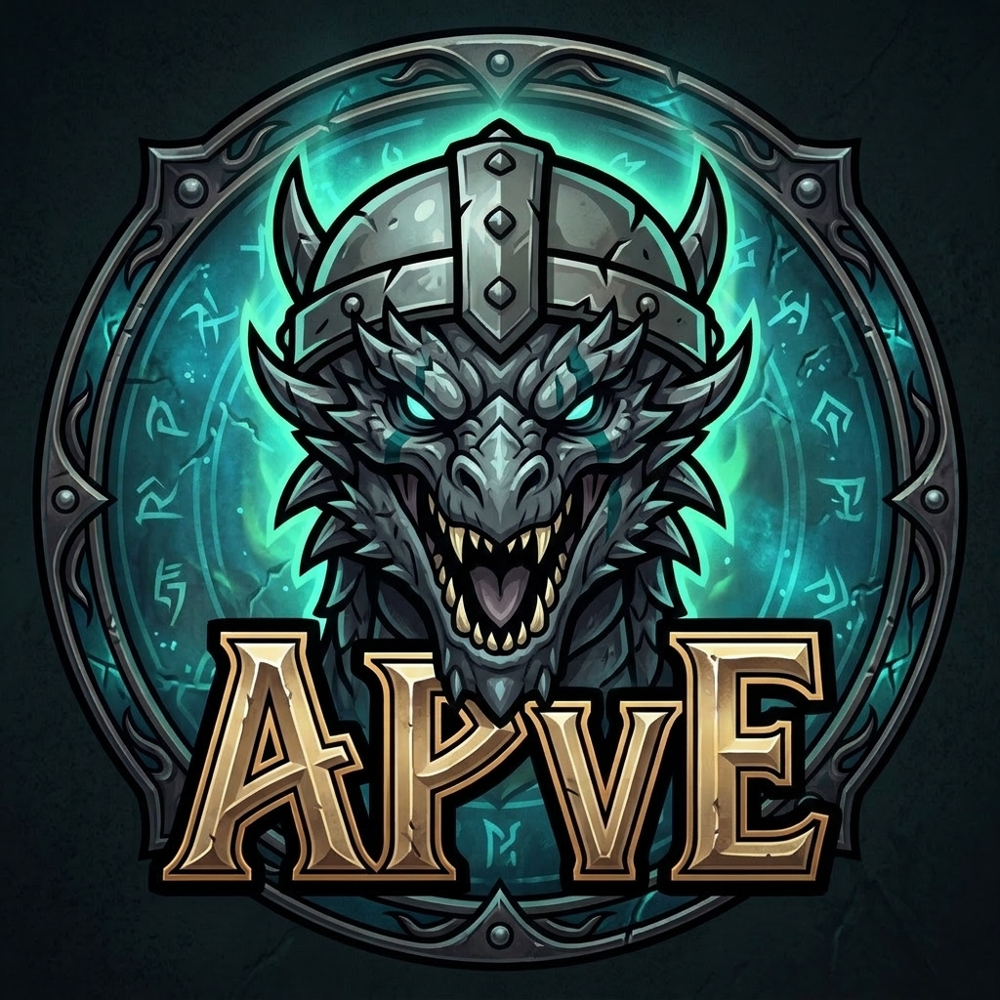

<p align="center">
  
</p>

# AndreddiPvE

An addon for **World of Warcraft: Forever** and **retail**. It keeps a history of the players you do dungeons, Mythic+ keys and raids with. This is the PvE sibling of AndreddiPvP.

## Install

Copy the `AndreddiPvE` folder into the client's AddOns folder:

| Client | AddOns folder |
|---|---|
| Forever | `World of Warcraft\_classic_beta_\Interface\AddOns\AndreddiPvE\` |
| Retail | `World of Warcraft\_retail_\Interface\AddOns\AndreddiPvE\` |

The folder must be named `AndreddiPvE`. Then reload or log in, and type `/apve`.

## One project, two clients

Both clients share every `.lua` file. Each client loads the `.toc` whose suffix matches it:

| File | Client | Interface |
|---|---|---|
| `AndreddiPvE_Forever.toc` | WoW: Forever | 16001 |
| `AndreddiPvE_Standard.toc` | Retail (Midnight) | 120105 |

Keep the two file lists identical, and use the same `## Version` line in both.

When a patch changes the interface number, update the `## Interface` line in that client's `.toc`. You can check the current number in game with `/dump select(4, GetBuildInfo())`.

### Character names

- **Retail:** players are stored as `Name-Realm`, and players from your own realm are shown without the realm.
- **Forever:** characters have a first name and a surname. `AndreddiPvE_Forever.toc` contains `## X-NameStyle: Surname`, which tells the addon to store full names like `First Surname`. When you type a name by hand (slash commands, *Add player*), use the full name.

## Features

- **Run history.** Every dungeon, key and raid you do with a group is saved. A run records:
  - the instance and difficulty, or the key level for Mythic+
  - when it started and how long it took (the key timer for completed keys)
  - the result: timed, over time, completed, abandoned, or how many bosses died
  - the bosses killed and the number of wipes
  - every group member, with their role, their deaths, and whether they left early
- **Ratings.** You can rate each player 1–10 for each run. Players and guilds show their average rating.
- **Rate-your-group popup.** When a dungeon or key ends, a popup lists the group. You can rate everyone, put them on a list and write a note. It doesn't open for raids; use *Rate group...* in the Runs tab for those.
- **Lists.** Players and whole guilds can go on *Always invite*, *Kick on sight* or *Ignore*. A player's own list wins over their guild's. Lists only warn you; nothing is automatic.
- **Right-click menu.** Right-click a player (portrait, party or raid frame, chat name, guild roster) to:
  - set their list
  - rate them for your last run together
  - edit their note
  - add them to your history by hand, for content the addon doesn't track on its own
  - rate or log your current group

  Your own portrait has the group options.
- **Alerts.** You get a toast, a sound and a chat line when someone you've played with, or someone on a list, does one of these:
  - joins your group
  - applies to your listed group (retail group finder)
  - shows up nearby (off by default)

  The toast shows your runs together, their rating, your last run and your notes. Ignored players never trigger an alert. Left-click a toast to open the player, right-click to dismiss it.
- **Tooltips.** Player tooltips, group finder leaders and applicants show your runs together, their rating, your last run, their list and your notes.
- **Statistics.** This tab shows:
  - runs, completion rate, keys timed and players met
  - runs per period and per instance (with your best timed key)
  - a 14-day chart
  - the players and guilds you play with most
  - your highest and lowest rated players
  - a switch between all characters and the current one

## How runs are detected

Everything below uses events that may not exist on every client. A missing event just means that part isn't recorded. You can always add players or groups by hand from the right-click menu.

- **Start:** you enter a dungeon or raid while in a group. Inserting a key turns the run into a Mythic+ run and restarts its clock.
- **Members:** the group roster is read every few seconds. Players who leave are marked, and players who come back are unmarked.
- **Deaths:** group members are checked every second. Forever gives addons no combat log, and Midnight hides it in instances.
- **Bosses and wipes:** `ENCOUNTER_END` and `BOSS_KILL`.
- **Completion:** one of these:
  - `CHALLENGE_MODE_COMPLETED` for keys, which also gives the key level, timer and upgrade
  - `LFG_COMPLETION_REWARD` for finder groups
  - a full clear of the instance lockout
- **End:** any of these:
  - you leave the group
  - you enter a different instance
  - you stay outside the instance for 15 minutes, so corpse runs and repair trips don't end the run

  A run under 2 minutes with no bosses, completion or ratings is thrown away.

## Slash commands

| Command | What it does |
|---|---|
| `/apve` | Open or close the run history |
| `/apve players`, `guilds`, `stats`, `settings` | Open a specific tab |
| `/apve invite`, `kick`, `ignore`, `clear` `[name]` | List your target or a named player |
| `/apve ginvite`, `gkick`, `gignore`, `gclear` `[Guild]` | List your target's guild or a named guild |
| `/apve note <text>` | Set a note on your target |
| `/apve rate <1-10>` | Rate your target for your last run together |
| `/apve group` | Rate your current group (logs it as a run if none is being tracked) |
| `/apve unlock`, `/apve lock` | Move the alert anchor |
| `/apve test` | Show test alerts |

The addon button next to the minimap opens the history on left-click and the settings on right-click.

## Custom sounds

Put `.ogg` or `.mp3` files in `AndreddiPvE\Sounds\`. Then add a line to `SOUND_CATALOG` in `UI/Alerts.lua`:

```lua
{ key = "mine", label = "My sound", file = "Interface\\AddOns\\AndreddiPvE\\Sounds\\mine.ogg" },
```

## Data

Everything is stored account-wide in `WTF\Account\<account>\SavedVariables\AndreddiPvE.lua`.
